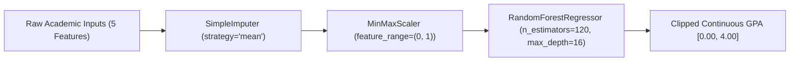

# Student GPA Prediction System with Email Verification & MySQL Authentication

[](LICENSE)
[](https://www.python.org/)
[](https://flask.palletsprojects.com/)
[](https://www.mysql.com/)
[](https://scikit-learn.org/)
[](#-model-architecture--performance)

A modern, full-stack machine learning web application that forecasts a student's end-of-semester GPA on a continuous 4.00 scale using five key academic indicators. Built with a **Flask** backend, an updated **scikit-learn Random Forest regression pipeline**, a **MySQL relational database** with parameterized queries and SHA-256 credential hashing, automated 6-digit SMTP email verification (OTP), and an editorial, warm-toned responsive user interface.

---

## Table of Contents

- [Overview](#overview)
- [Key Features](#key-features)
- [Model Architecture & Performance](#model-architecture--performance)
- [Tech Stack & Package Versions](#tech-stack--package-versions)
- [Database Schema](#database-schema)
- [Project Structure](#project-structure)
- [Getting Started](#getting-started)
  - [Prerequisites](#prerequisites)
  - [Installation](#installation)
  - [Database Setup](#database-setup)
  - [Environment Variables](#environment-variables)
  - [Running the Application](#running-the-application)
- [Dataset & Model Retraining](#dataset--model-retraining)
- [Security Architecture](#security-architecture)
- [Author & Contact](#author--contact)
- [License](#license)

---

## Overview

Predicting academic performance early allows students and advisors to make timely interventions rather than reacting to final grades. This application evaluates five quantitative academic metrics:

1. **Attendance (%)**: Class attendance rate (0% – 100%).
2. **Weekly Study Hours**: Dedicated self-study time per week (0 – 20 hrs).
3. **Previous CGPA**: Cumulative Grade Point Average prior to current term (0.00 – 4.00).
4. **Quiz Performance (%)**: Continuous assessment and test score average (0% – 100%).
5. **Class Participation (1–10)**: Active classroom engagement score (1 – 10).

The machine learning pipeline analyzes these factors and outputs a predicted GPA alongside a nuanced academic standing recommendation. User accounts and authentication are managed through a persistent **MySQL relational database**.

---

## Key Features

- **MySQL Database Authentication**: User accounts, email verification records, and SHA-256 password digests are persisted in a relational MySQL database with parameterized queries (`pymysql`) and indexing.
- **Auto Database Initialization**: The application automatically checks, creates the database (`gpa_predictor`), and provisions the `users` table upon server startup.
- **High-Precision ML Forecasting**: 97.6% $R^2$ accuracy model trained on 4,000 synthesized student records with realistic academic correlation weighting.
- **Split-Layout Authentication**: Elegant dual-pane layout for Sign In, Sign Up, and Verification with a 6-cell interactive OTP digit input and asynchronous resend cooldown.
- **Responsive & Accessible**: Floating glassmorphic navbar with mobile drawer, full viewport clipping (`overflow-x: clip`), smooth animations via AOS, and complete support down to 320px mobile screens.

---

## Model Architecture & Performance

The predictive model is structured as a scikit-learn `Pipeline`:



### Benchmark Metrics (Tested on 800 unseen test samples)

| Metric | Score | Description |
| :--- | :--- | :--- |
| **5-Fold Cross-Validation $R^2$** | **97.72%** ($\pm 0.34\%$) | Generalization stability across all folds |
| **Testing $R^2$ Score** | **97.63%** | Variance explained on unseen test records |
| **Mean Absolute Error (MAE)** | **0.0534 GPA points** | Average prediction margin under 0.06 GPA |
| **Root Mean Squared Error (RMSE)** | **0.0781 GPA points** | Penalizes larger outlier deviations |

### Prediction Standing Tiers

| Predicted GPA | Standing Category | System Feedback |
| :---: | :---: | :--- |
| **$\ge 3.50$** | `Excellent` | *"On track for an outstanding semester. Keep that rhythm going."* |
| **$3.00$ – $3.49$** | `Great job` | *"Performing solidly above average. A little extra polish lifts you into top tier."* |
| **$2.50$ – $2.99$** | `Satisfactory` | *"On steady ground. Consistent effort over coming weeks pushes you above 3.0."* |
| **$2.00$ – $2.49$** | `Passing` | *"Passing with room to grow. Focus on study hours and quiz prep."* |
| **$< 2.00$** | `At risk` | *"Immediate signal to reach out to advisors and adjust habits early."* |

---

## Tech Stack & Package Versions

### Core Dependencies

The exact pinned packages used to build, train, and run this project:

| Package | Version | Purpose |
| :--- | :---: | :--- |
| **[Flask](https://pypi.org/project/Flask/)** | `3.1.3` | Lightweight web backend and route management |
| **[PyMySQL](https://pypi.org/project/PyMySQL/)** | `1.2.3` | Pure-Python MySQL client with parameterized query support |
| **[scikit-learn](https://pypi.org/project/scikit-learn/)** | `1.9.1` | ML preprocessing pipeline and Random Forest regressor |
| **[joblib](https://pypi.org/project/joblib/)** | `1.6.0` | High-efficiency model serialization and loading |
| **[pandas](https://pypi.org/project/pandas/)** | `3.0.6` | Dataset manipulation, DataFrame feature alignment |
| **[numpy](https://pypi.org/project/numpy/)** | `2.5.3` | Numerical computing, vector scaling, and clipping |
| **[python-dotenv](https://pypi.org/project/python-dotenv/)** | `1.2.2` | Loading environment variables from `.env` |
| **[email-validator](https://pypi.org/project/email-validator/)** | `2.3.0` | Strict email syntax validation during sign-up |

### Database
- **MySQL 8.0+ / 9.x** (or MariaDB 10.4+)
- Character Set: `utf8mb4`, Collation: `utf8mb4_unicode_ci`

### Frontend & Styling
- **HTML5 & Jinja2 Templates**
- **Custom CSS3**: Modular warm palette, CSS variables, glassmorphism, responsive grid & flexbox layouts.
- **JavaScript (ES6)**: Real-time slider sync, interactive OTP paste/input management, dynamic SVG ring animation, and word-by-word text revealing.
- **Typography**: Google Fonts *Fraunces* (editorial serif headings), *Plus Jakarta Sans* (clean modern body), *JetBrains Mono* (code/metrics).
- **Libraries (CDN)**:
  - [Animate On Scroll (AOS)](https://michalsnik.github.io/aos/) `2.3.4`
  - [Font Awesome Icons](https://fontawesome.com/) `6.4.0`

---

## Database Schema

The database schema is defined in [`schema.sql`](schema.sql):

```sql
CREATE DATABASE IF NOT EXISTS gpa_predictor
    DEFAULT CHARACTER SET utf8mb4
    DEFAULT COLLATE utf8mb4_unicode_ci;

USE gpa_predictor;

CREATE TABLE IF NOT EXISTS users (
    id INT AUTO_INCREMENT PRIMARY KEY,
    name VARCHAR(255) NOT NULL,
    email VARCHAR(255) NOT NULL,
    hashed_name VARCHAR(64) NOT NULL,
    hashed_email VARCHAR(64) NOT NULL UNIQUE,
    hashed_password VARCHAR(64) NOT NULL,
    created_at TIMESTAMP DEFAULT CURRENT_TIMESTAMP,
    INDEX idx_hashed_email (hashed_email),
    INDEX idx_email (email)
) ENGINE=InnoDB DEFAULT CHARSET=utf8mb4 COLLATE=utf8mb4_unicode_ci;
```

---

## Project Structure

```text
Student-GPA-Prediction-System/
├── app.py                     # Main Flask application, MySQL queries & routing logic
├── schema.sql                 # MySQL schema DDL (database & table creation)
├── requirements.txt           # Pinned Python package dependencies (including PyMySQL)
├── .env                       # Environment configuration (ignored by git)
│
├── models/
│   └── final_gpa_model.pkl    # Serialized scikit-learn Pipeline (v1.9.1)
│
├── templates/
│   ├── base.html              # Base layout with navbar, footer, toast stack
│   ├── home.html              # Landing page with preview ring, timeline, specs
│   ├── index.html             # Predictor workspace with sliders & dynamic ring
│   ├── email_input.html       # Sign up page with password meter
│   ├── signin.html            # Sign in page
│   ├── verify_code.html       # 6-box OTP email verification page
│   └── partials/
│       ├── auth_aside.html    # Reusable warm side panel for auth pages
│       └── form_errors.html   # Contextual inline error alert component
│
├── static/
│   ├── css/
│   │   ├── style.css          # Core stylesheet (palette, layout, components)
│   │   └── animations.css     # Keyframes, word-by-word reveal, reduced-motion
│   └── js/
│       └── main.js            # Navbar, OTP sync, ring animation, validation
│
└── others/
    ├── Creating_dataset.py    # Generates 4,000 synthetic student records
    ├── student_performance_data.csv # Synthetic student training dataset
    ├── train_model.py         # Model training, CV evaluation & export script
    └── Creating_dataset.ipynb # Exploratory data analysis notebook
```

---

## Getting Started

### Prerequisites

- **Python**: Version `3.10` or higher (tested with Python 3.10 – 3.13)
- **pip** package manager
- **MySQL Server**: Version `8.0` or higher / `9.x` (or MariaDB 10.4+)

### Installation

1. **Clone or download the project folder**:
   ```bash
   git clone https://github.com/komailahmad/gpa-prediction-system.git
   cd gpa-prediction-system
   ```

2. **Create and activate a virtual environment**:
   ```bash
   # Windows (PowerShell)
   python -m venv venv
   .\venv\Scripts\Activate.ps1

   # Linux / macOS
   python3 -m venv venv
   source venv/bin/activate
   ```

3. **Install the required dependencies**:
   ```bash
   pip install -r requirements.txt
   ```

### Database Setup

You have two options to set up the MySQL database:

- **Option A (Automatic - Recommended)**: Simply ensure your MySQL server is running. When you launch `python app.py`, the built-in `init_db()` function will automatically create the `gpa_predictor` database and `users` table if they do not already exist.
- **Option B (Manual via CLI)**:
  ```bash
  mysql -u root -p < schema.sql
  ```

### Environment Variables

Create or update a `.env` file in the project root directory:

```ini
# Flask Session Key
SECRET_KEY=your_super_secret_session_key

# SMTP 2FA Email Configuration
SENDER_EMAIL=your_email@gmail.com
SENDER_PASSWORD=your_gmail_app_password
SMTP_SERVER=smtp.gmail.com

# MySQL Database Configuration
MYSQL_HOST=localhost
MYSQL_PORT=3306
MYSQL_USER=root
MYSQL_PASSWORD=your_mysql_password
MYSQL_DB=gpa_predictor
```

> **Note**: For Gmail, generate a 16-character **App Password** via [Google Account Security](https://myaccount.google.com/apppasswords). Do not use your regular account password.

### Running the Application

Start the Flask server:

```bash
python app.py
```

Open your browser and navigate to:
```text
http://127.0.0.1:5001/
```

---

## Dataset & Model Retraining

To recreate the dataset and retrain the model locally at any time:

1. **Regenerate the synthetic dataset**:
   ```bash
   python others/Creating_dataset.py
   ```
   *Generates 4,000 student records saved to `others/student_performance_data.csv`.*

2. **Train and evaluate the model**:
   ```bash
   python others/train_model.py
   ```
   *Executes 5-fold cross-validation, prints train/test $R^2$, MAE, RMSE metrics, and exports the model to `models/final_gpa_model.pkl`.*

---

## Security Architecture

- **SQL Injection Prevention**: All queries utilize parameterized `%s` statements executed through PyMySQL.
- **Hashed Passwords**: User passwords are never saved in plain text. Credentials use SHA-256 digests (`hashlib.sha256`) during registration and authentication.
- **Two-Factor Email Verification**: Newly registered accounts remain pending in temporary session memory until the 6-digit OTP received via Gmail TLS SMTP (port 587) is validated. Only upon verification is the record committed to the MySQL database.
- **Multi-Part Branded HTML Emails**: Verification emails are sent using standard multi-part MIME (`EmailMessage`) with responsive inline styling matching the web interface, accompanied by an accessible plain-text alternative.
- **Seamless Asynchronous Requests**: Forecast requests and verification code resends are executed via background AJAX/fetch calls with session verification, preventing CSRF or unauthenticated leaks while eliminating full-page refreshes.
- **Session Authentication Guard**: The predictor workspace (`/index`) is strictly guarded; unauthenticated requests are redirected to `/signin`.
- **Defensive Error Handling**: Input syntax is checked before submission, preventing invalid form submissions and brute-force errors.

---

## Author & Contact

- **Author**: Komail Ahmad
- **Email**: [komikhalils091@gmail.com](mailto:komikhalils091@gmail.com)
- **GitHub**: [@KomailMK](https://github.com/KomailMK)
- **LinkedIn**: [Komail Ahmad](https://www.linkedin.com/in/get-in-touch-with-komail-ahmad)

---

## License

This project is licensed under the [MIT License](LICENSE) feel free to fork, customize, and extend it for academic and non-commercial use.
